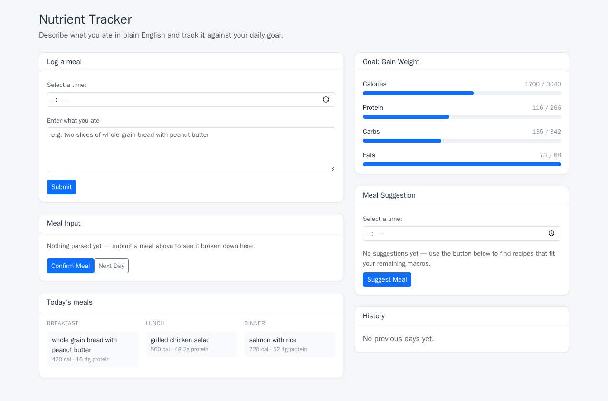

# Nutrient tracker

A web app that takes a meal described in plain English, works out its nutrition, tracks it against a daily target derived from body metrics, and suggests recipes sized to the macros left in the day.

Built over 4 days in January 2025 for the Monash DeepNeuron On-Hit application (Stage 2).

The January 2025 commits are the original build. Later commits covering bug fixes, containerisation and documentation were written with AI assistance, and are marked as co-authored in the commit history.



## The problem

Home cooking doesn't fit a calorie tracker. Portions and ingredients vary from meal to meal, and standard apps only recognise typical pre-indexed meals, which leaves doubt over whether the number that comes back matches what was actually eaten.

The other half is working out what to cook. Knowing what a day still needs doesn't answer what dish would cover it.

This app covers both: free text goes in, recipe suggestions sized to the remaining macros come out.

Photo recognition was considered and scoped out during planning, on time constraints and uncertainty about whether it would work on a tester's device. That decision and the ones reversed later are recorded in [Design Rationale.md](Design%20Rationale.md).

## Features

**Measurement:** free-text input such as "a whole grain bread with peanut butter jam" is sent to the Nutritionix natural-language endpoint and parsed into calories, protein, carbs and fats. A confirmation step sits between the parse and the save.

**Tracking:** meals are bucketed into breakfast, lunch or dinner by hour (to 10:59, to 16:59, and later) and accumulate against the day's target. The target comes from the Mifflin-St Jeor equation using gender, weight, height, age and activity level, shifted by ±500 kcal for a gain or loss goal, then split into protein/carbs/fats ratios of 35/45/20 for gain and 30/45/25 for loss. Completed days roll into a history.

**Suggestion:** Spoonacular is queried for recipes matching the macros still unspent, with each suggestion aimed at a third of the daily goal. A suggestion can be logged back as a meal in one click.

## Code map

| File | Contents |
|---|---|
| [`backend/controllers/Database-controller.js`](backend/controllers/Database-controller.js) | Nutrition maths: TDEE, macro split, time-of-day bucketing, day rollover |
| [`backend/controllers/ExternalAPI-controller.js`](backend/controllers/ExternalAPI-controller.js) | Both external integrations, including the translation from remaining macros into a bounded recipe query |
| [`backend/model/Day.js`](backend/model/Day.js) | Per-day progress, added partway through the build |
| [`Design Rationale.md`](Design%20Rationale.md) | Day-by-day reasoning written during the original build |

The original design had only `User` and `Meal`. `Day` was added partway through, once the history section needed somewhere to centralise each day's progress.

## Stack

| Layer | Choice |
|---|---|
| Frontend | Angular 19 |
| Backend | Node and Express |
| Database | MongoDB with Mongoose |
| External | Nutritionix, Spoonacular |

```
backend/
  App.js              Express entry point, serves the built frontend
  router/             Endpoints, split by concern
  controllers/        Request handling, nutrition maths, external API calls
  model/              Mongoose schemas: User, Meal, Day
frontend/
  src/app/            Angular app
```

Routers and controllers are split along the 2 things the app does: database operations under `/api/database` and external API operations under `/api/external-api`.

## Running it

With Docker, which starts MongoDB alongside the app:

```bash
cp .env.example .env     # add Nutritionix and Spoonacular keys
docker compose up --build
```

The app is then at `http://localhost:3100`. Setting `PORT` in `.env` changes it.

Without Docker, a reachable MongoDB instance and Node 20.11+ or 22+ are required (the range Angular 19 supports; the Docker image uses Node 22):

```bash
cp .env.example backend/.env    # add keys and MONGODB_URI

cd frontend && npm ci && npm run build
cd ../backend && npm ci && npm start
```

The app is then at `http://localhost:8080`. For frontend work with hot reload, `npm start` in `frontend/` serves on `http://localhost:4200`.

## Trade-offs

**One user, no auth:** every query resolves the user with an unfiltered `findOne()`. Supporting multiple users means adding authentication and scoping every query by user ID.

**Day rollover is manual:** a button advances the tracker instead of a scheduled job.

**Suggestions consider macros only:** cuisine preference was in the original feature list, marked as optional, and wasn't built. Spoonacular supports filtering on it.

**Nutritionix now requires a paid plan:** the free tier this was built against has since been retired. Goal calculation, tracking, history and Spoonacular suggestions all work without it, and meals can still be logged through `POST /api/database/meal/add` directly.

## Credits

Meal parsing by [Nutritionix](https://www.nutritionix.com/business/api). Recipe suggestions by [Spoonacular](https://spoonacular.com/food-api).
